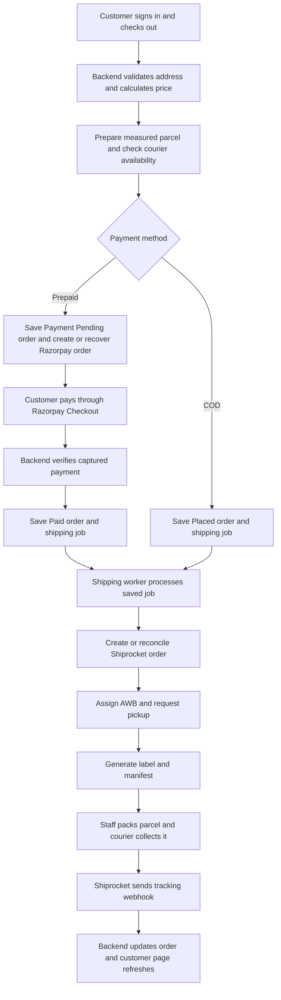

# Current Razorpay and Shiprocket workflow

Based on the current BrainyGrasp source code and local configuration reviewed on 19 November 2026. This describes implemented behavior; the deployed server, live payments and actual shipments have not been verified.

**Razorpay handles online payment. Shiprocket handles shipment booking and courier tracking. Your backend connects them through a saved shipping job after order confirmation.** A confirmed payment and a confirmed shipment are separate results.

## 1. What the current settings actually allow

| Setting checked locally | Current state | Effect |
| --- | --- | --- |
| `NODE_ENV` | `development` | Live shipping is blocked by the production guard |
| Razorpay key mode | Test | Online checkout uses the test-payment flow if the configured credentials and services work |
| `SHIPROCKET_ENABLED` | Missing, treated as disabled | No automatic Shiprocket booking |
| Shiprocket credentials and shipping settings | Missing/empty | Live authentication and booking are not configured |
| Package profiles | Missing | Measured shipping boxes must be configured before activation |
| Production Compose file | No Shiprocket environment mappings | Adding values to the environment file alone will not inject them into the backend container |

These are local findings. A deployed server can have different environment values.

With these local settings:

- A COD checkout can save a `Placed` order, assuming the application/database are running. Its shipping job is held as `awaiting_parcel`.
- A successfully verified Razorpay test payment can save a `Paid` order. This is test-mode confirmation, not proof that real money was collected. Its shipping job is also held as `awaiting_parcel`.
- Disabled shipping skips courier availability and parcel preparation at checkout. The order records an address snapshot and the reason shipping was held.
- Neither path automatically creates a Shiprocket order, AWB, pickup or shipping documents.
- Enabling shipping later does not automatically release these old held orders. Test-paid prepaid orders remain ineligible for live shipping.

## 2. Overall flow once live shipping is configured

The following shows the implemented live flow. It is not active under the local settings above.



Shiprocket is contacted before payment for **serviceability**, but a new prepaid shipment is booked only after the backend verifies a live captured payment. Razorpay does not directly call Shiprocket in this project.

## 3. Steps shared by COD and prepaid checkout

1. The customer signs in, chooses products, supplies a delivery address and selects COD or Razorpay.
2. The frontend saves a checkout attempt with a unique request key so a network retry can resume the same order.
3. The backend validates ownership of the address, required address fields, a ten-digit phone number and a six-digit PIN.
4. The backend loads product prices from the database and validates quantities and promo codes. Browser-supplied prices are not authoritative.
5. It calculates the order total and saves the purchased item details. Current customer shipping is INR 60 below an INR 999 merchandise subtotal and free at/above that subtotal. Promo discounts are applied separately.
6. If shipping is enabled, the backend validates production shipping configuration, uses product measurements and box profiles to calculate one parcel, and asks Shiprocket whether a courier supports that parcel, destination and payment method.
7. Missing measurements, an unsuitable box or an unsupported destination block a new checkout before its payment order is created or COD order is confirmed.
8. The saved shipping snapshot preserves the destination, parcel, package, packing details and booking configuration for that order.

The customer shipping fee follows store pricing policy; it is not replaced with Shiprocket's quoted courier charge. The actual courier charge may differ.

Source: [checkout pricing and confirmation](backend/checkoutService.js), [shipping preparation](backend/shippingCheckout.js), [frontend checkout](frontend/js/checkout_cod.js).

## 4. Prepaid workflow: Razorpay first, then shipment booking

### A. Create the payment order

The frontend calls `POST /api/payment/create-order`.

The backend performs the shared checks, then saves a store order with:

- Payment method: `razorpay`.
- Status: `Payment Pending`.
- The saved basket, amount in paise, INR currency, checkout key and Razorpay key ID used for this attempt.
- The shipping snapshot from checkout.

It then creates or recovers the associated Razorpay order. A stable receipt helps recover a remote order if an earlier response was lost. The frontend receives the Razorpay order ID, public key ID and server-calculated amount and opens Razorpay Checkout. Secret keys remain on the backend.

At this point, there is **no shipping job for this pending prepaid order**.

### B. Verify the payment

Three paths can establish payment confirmation:

| Path | What happens |
| --- | --- |
| Browser success callback | Frontend calls `POST /api/payment/verify`; backend checks the signature and fetches payment details from Razorpay |
| Razorpay webhook | `POST /api/webhooks/razorpay` accepts signed `payment.captured` or `order.paid` events and fetches the payment for verification |
| Resume/status check | `GET /api/payment/orders/:id` checks payments on the saved Razorpay order and can recover a captured payment |

The backend checks the order/payment relationship, amount, currency and payment identity. A newly confirmed payment must be fully captured with no refunded amount. An `authorized` or `created` payment remains pending. This code does not itself capture an authorized payment.

The browser showing success is therefore only an input to verification. It does not directly mark the order paid or ship it.

### C. Confirm once and hand off to shipping

After successful verification, one database transaction:

1. Changes the store order from `Payment Pending` to `Paid`.
2. Saves the payment ID and verification timestamp.
3. Removes purchased quantities from the saved cart while preserving unrelated quantities.
4. Applies the existing affiliate commission/wallet effects if eligible.
5. Inserts one shipping job for the order.

When shipping was enabled at checkout and the payment is verified under a live Razorpay key, the job starts as `queued`. When shipping was disabled, it starts as `awaiting_parcel` for review.

Repeated browser callbacks, status checks or webhooks reuse the confirmed payment instead of repeating confirmation effects. The shipping worker acts after this transaction commits, so the payment request does not wait for courier booking to finish.

Source: [payment service](backend/paymentService.js), [payment endpoints](backend/routes/payment.js), [confirmation effects](backend/checkoutService.js).

## 5. COD workflow: place the order, then book shipping

The frontend calls `POST /api/orders` with payment method `cod`. This endpoint rejects attempts to submit an online payment through the COD route.

1. The backend performs the shared price, address and shipping checks.
2. It saves the order as `Placed`, with payment method `cod`.
3. In the same transaction, it updates the cart, applies eligible affiliate effects and inserts the shipping job.
4. If shipping was enabled at checkout, the job is `queued`; otherwise, it is `awaiting_parcel`.
5. The worker sends the order to Shiprocket with payment method `COD`.

There is no Razorpay checkout, payment signature or captured-payment requirement for COD. Placing a COD order means the order has been accepted; it does not mean the customer has paid. Cash collection and remittance occur through the courier/Shiprocket operation, and this application does not automatically reconcile COD remittances.

Source: [COD order endpoint](backend/routes/orders.js).

## 6. What the Shiprocket worker does

The running backend starts a worker immediately and checks again every 15 seconds. It processes saved tracking events and, when shipping is enabled, eligible shipping jobs. A persistent PostgreSQL database preserves progress across restarts.

For a shipping job, it:

1. Locks the order so concurrent workers/admin requests cannot process the same booking simultaneously.
2. Checks order eligibility, totals, parcel details and saved booking configuration. New prepaid bookings require verified live payment details.
3. Selects a courier when none is saved, using current serviceability. The client prefers Shiprocket's recommended courier, otherwise the lowest returned usable rate.
4. Looks for an existing Shiprocket order with the saved reference and channel before creating one.
5. Creates a shipment if appropriate, then reads it back to verify its reference, channel, payment mode and amount.
6. Assigns an AWB if none exists. AWB is the courier's tracking/waybill number.
7. Requests pickup if it has not already been confirmed.
8. Generates a shipping label and manifest and saves their links.
9. Marks the shipping job `completed` once those booking steps finish.

Each stage is saved before the next external action. If a create/AWB/pickup response is uncertain, the code reads the existing remote state instead of blindly issuing another creation request. Document retries preserve the existing pickup.

**A completed shipping job means booking and documents are ready. It does not mean the parcel has been delivered.** Staff still need to print documents, pack the recorded box and hand it to the courier. Pickup timing depends on the courier.

Source: [worker](backend/orderFulfillment.js), [job storage and retries](backend/shippingJobs.js), [booking stages](backend/shipmentBooking.js), [Shiprocket client](backend/shiprocketService.js).

## 7. Tracking from Shiprocket to the customer

1. Shiprocket sends a JSON POST to `/api/delivery-events` with the configured `x-api-key` security token.
2. The backend validates the token and payload and saves the event before returning HTTP 200. Duplicate normalized events share a stored identifier.
3. The worker matches the AWB to the order and applies recognized courier status updates.
4. It updates the stored status, courier information and available estimated delivery date, then invalidates the order cache.
5. The signed-in customer dashboard requests `/api/orders?fresh=1` every 30 seconds while visible, so it reads current database information. Returning to the tab also refreshes it.

Typical status progression is:

```text
Prepaid: Payment Pending -> Paid -> Confirmed -> Shipped -> Out for Delivery -> Delivered
COD:                       Placed -> Confirmed -> Shipped -> Out for Delivery -> Delivered
```

This is a typical progression, not a requirement that every intermediate event arrives. AWB/pickup tracking maps to `Confirmed`; picked-up/in-transit events map to `Shipped`. Cancellation and return events can map to `Cancelled` or `RTO`. Older timestamped events and backward status changes are guarded against; unrecognized statuses do not advance the order.

Booking stores shipment/AWB details separately from the visible order status. That status may still show `Paid` or `Placed` until tracking or an allowed admin action updates it.

The 15-second worker cycle and 30-second visible-page refresh provide near-real-time updates after Shiprocket reports an event. They are not a guaranteed delivery time for updates or continuous GPS tracking. The worker is not polling every shipment's courier status every 15 seconds; automatic tracking is driven by incoming webhooks. Admin can request a direct courier refresh separately.

Source: [webhook route](backend/routes/shiprocket.js), [event processing](backend/deliveryTracking.js), [status mapping](backend/shippingPolicy.js), [customer dashboard](frontend/js/dashboard-new.js).

## 8. Automatic work versus admin work

| Automatic when correctly configured | Admin or operations action |
| --- | --- |
| Validate price, address, measurements and courier serviceability | Maintain actual product/box measurements and correct pickup settings |
| Verify captured Razorpay payments and recover via webhook/status checks | Resolve payment exceptions and old payment configurations |
| Insert shipping jobs after confirmation | Review held orders and supply a measured parcel where needed |
| Create/reconcile shipment, assign AWB, request pickup and generate documents | Print documents, pack the box and arrange physical handover |
| Process tracking webhooks and refresh the customer page | Use Refresh courier tracking when a direct lookup is needed |
| Retry eligible booking failures | Resolve wallet, address, account or courier issues; review and resume jobs |

In **Admin > Orders > Shipping details**:

- **Refresh progress** reads saved shipping job progress.
- **Queue / resume shipment** queues an eligible held job or resumes its saved stage. Existing references and parcels are preserved on resume. A queued response is not pickup confirmation.
- **Refresh courier tracking** asks Shiprocket for the current AWB status and applies the result locally.
- Label/manifest links support packing and handover.

Payment and booking guards restrict local status edits. A manual status change cannot substitute for verified live payment or cancel a remote courier pickup. Cancel shipments in Shiprocket and handle Razorpay refunds separately.

Source: [admin endpoints](backend/routes/admin.js), [admin order interface](admin/js/orders.js).

## 9. What happens when something fails

| Situation | Current behavior |
| --- | --- |
| Browser retries the same checkout | Saved request key and basket identity let the backend reuse the order; changed details with the same key are rejected |
| Razorpay order creation response is lost | Backend can locate the existing remote order using its stable receipt |
| Customer closes payment window or a payment attempt fails | The pending checkout is retained for resume; a failed attempt does not automatically cancel an order that could later be paid |
| Payment is authorized but not captured | Remains pending; no payment confirmation effects or shipping job |
| Browser closes after a successful payment | A valid Razorpay webhook or later payment-status check can confirm it |
| Payment gateway cannot be reached | Backend does not assume payment succeeded; the order can be retried/reviewed |
| Payment succeeded but shipping fails later | Payment remains verified; shipping retries or requires review. No automatic refund is issued |
| Retryable shipping failure | Increasing delays, with up to six failed attempts before review; nonretryable failures may require review immediately |
| Unknown result of shipment/AWB/pickup creation | Read-back reconciliation; unresolved uncertainty is held for review rather than a fresh duplicate creation |
| Label or manifest fails after pickup confirmation | Existing pickup is preserved; document generation can resume |
| Tracking AWB is not matched yet | Event is stored and retried later, eventually requiring review if unresolved |
| Service sleeps or stops | Worker cannot process pending work until the backend runs again |
| Razorpay keys change on an existing pending order | The old checkout is rejected for review rather than silently switching its payment configuration |
| Shipping is enabled after an old checkout | Old held shipping jobs do not automatically become queued; test-paid shipments remain blocked |

There is no separate scheduled Razorpay payment-reconciliation worker in the reviewed flow. Payment recovery relies on the callback, Razorpay webhooks or the payment-status endpoint. The recurring worker described above handles shipping and delivery events.

## 10. Boundaries of the current implementation

- Payment verification is distinct from bank settlement; the application does not reconcile settlement payouts.
- Shipping currently uses one pickup location and one parcel per order. It does not automatically split baskets across boxes or warehouses.
- Shipping availability is checked at checkout and during initial courier selection, but a later booking can still fail because remote conditions change.
- Automated refunds, remote cancellation, return/NDR handling and inventory reservation are not implemented in this payment/shipping flow.
- Eligible affiliate commissions are recorded on order confirmation, including COD placement, rather than waiting for delivery or COD remittance. The admin cancellation route has reversal logic; tracking cancellation processing does not itself run that same reversal workflow.
- Creating the setup documentation has not changed production configuration or enabled either live service.

For activation instructions, see [Shiprocket live setup](shiprocket.md) and [Razorpay live setup](backend/razorpay.md). This file explains the current workflow; those guides explain how to configure and verify live operation.
